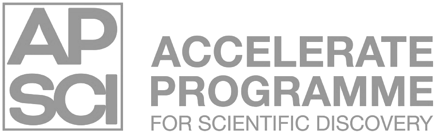

<div align="center">

<a href="https://science.ai.cam.ac.uk/">
  
</a>

# Hands-On Agentic AI

**A practical workshop on building and understanding agentic AI systems for scientific research.**

[Course website](https://docs.science.ai.cam.ac.uk/hands-on-agentic-ai/) ·
[Report an issue](https://github.com/acceleratescience/hands-on-agentic-ai/issues) ·
[Accelerate Science](https://science.ai.cam.ac.uk/)

[](./LICENSE)
[](https://github.com/acceleratescience/hands-on-agentic-ai/issues)
[](https://github.com/acceleratescience/hands-on-agentic-ai/pulls)
[](https://github.com/acceleratescience/hands-on-agentic-ai/stargazers)

</div>

## Overview

This repository contains the materials for the **Hands-On Agentic AI** workshop from [Accelerate Science](https://science.ai.cam.ac.uk/).

The workshop provides a practical introduction to building AI systems that go beyond individual language-model calls. The emphasis is on understanding how the components of an agentic system fit together and gaining experience by working directly with code.

The material is designed primarily for researchers and developers interested in applying agentic AI to scientific research.

For the guided version of the workshop, use the:

**[Hands-On Agentic AI course website →](https://docs.science.ai.cam.ac.uk/hands-on-agentic-ai/)**

## Prerequisites

You should be comfortable with:

- Python
- Jupyter notebooks
- basic object-oriented programming
- Git and GitHub
- working in a code editor such as VS Code

The project requires **Python 3.11 or newer**.

Some familiarity with large language models is helpful. If you are new to LLMs, we recommend completing our introductory material first:

**[Introduction to Large Language Models →](https://github.com/acceleratescience/large-language-models)**

## Getting started

We recommend running the workshop using **GitHub Codespaces**, which provides a preconfigured development environment in your browser.

### 1. Fork this repository

Click **Fork** at the top of this repository to create your own copy.

### 2. Open your fork in GitHub Codespaces

Follow the setup instructions in the course documentation:

**[Setting up with Codespaces →](https://docs.science.ai.cam.ac.uk/hands-on-agentic-ai/setting-up/codespaces/)**

### 3. Follow the workshop

Once your environment is running, work through the material using the course website:

**[Start the workshop →](https://docs.science.ai.cam.ac.uk/hands-on-agentic-ai/)**

## Repository structure

The repository contains the Agentic AI workshop alongside supporting material from the Hands-On LLM course.

```text
.
├── Hands-On-Agentic-AI/   # Agentic AI workshop materials
├── Hands-On-LLMs/         # Supporting LLM material
├── assets/                # Repository assets
├── mkdocs.yml             # Documentation configuration
├── pyproject.toml          # Python project configuration
└── uv.lock                # Locked Python dependencies
```

## Contributing

This workshop is actively developed. Agentic AI tooling changes quickly, so examples may occasionally need updating.

Contributions, bug reports, and suggestions are welcome.

To contribute:

1. Fork the repository.
2. Create a branch:
   ```bash
   git checkout -b feature/my-improvement
   ```
3. Make and commit your changes.
4. Push your branch.
5. Open a pull request.

You can also [open an issue](https://github.com/acceleratescience/hands-on-agentic-ai/issues) to report a bug or suggest an improvement.

## Related resources

- [Accelerate Science](https://science.ai.cam.ac.uk/)
- [Hands-On Agentic AI documentation](https://docs.science.ai.cam.ac.uk/hands-on-agentic-ai/)
- [Large Language Models introductory course](https://github.com/acceleratescience/large-language-models)
- [Hands-On LLMs](https://github.com/acceleratescience/hands-on-llms)

## License

This project is distributed under the **GNU General Public License v3.0 or later (GPL-3.0-or-later)**.

See [LICENSE](./LICENSE) for details.